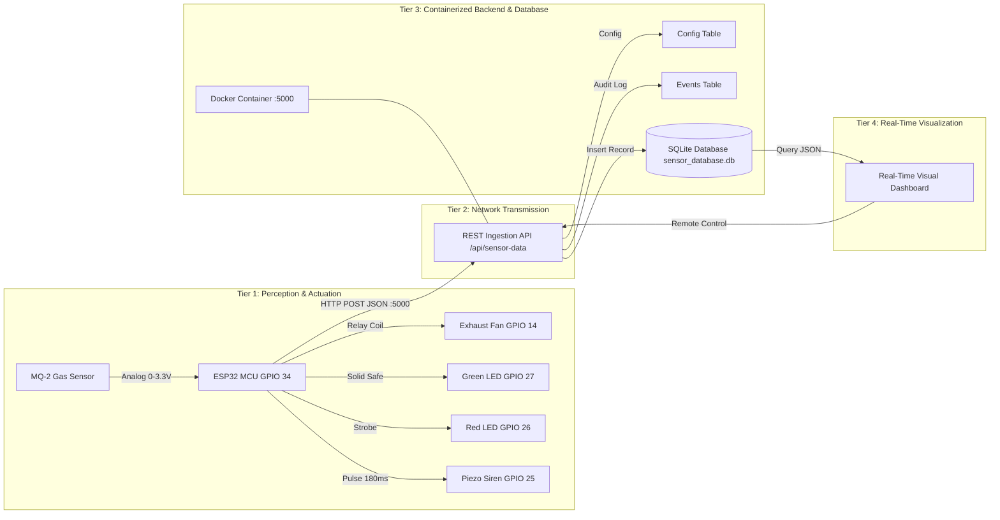

# 🛡️ Aura GasGuard™ — IoT Gas Leakage Detection System
## Technical Project Report & Architectural Specification

**Course/Assignment Requirement:** IoT Prototype with ESP32, Sensor Module, Containerized Backend, Relational Database, and Real-Time Dashboard  
**Firmware Version:** 3.0 (Cloud & Container Ready)  
**Backend Framework:** Python REST Engine (Containerized with Docker & Docker Compose)  
**Database:** SQLite 3 (Persistent Relational Time-Series Engine)  

---

## 📌 Compliance Matrix Against Project Criteria

| Assignment Criterion | Implementation in this Project | Verification Status |
| :--- | :--- | :---: |
| **1. ESP32 & Sensor Module** | ESP32 30-Pin NodeMCU DevKit V1 interfaced to an analog **MQ-2 Electrochemical Gas/Smoke Sensor** on `GPIO 34` (ADC1_CH6). | ✅ COMPLETE |
| **2. Data Communication** | High-efficiency **HTTP REST / JSON** protocol transmitting structured telemetry (`POST /api/sensor-data`) every 2 seconds. | ✅ COMPLETE |
| **3. Containerized Backend** | Multi-platform **Dockerfile** and **`docker-compose.yml`** orchestrating the backend service on port `5000:5000` with volume mounts. | ✅ COMPLETE |
| **4. Database Support** | Relational **SQLite database** (`data/sensor_database.db`) with tables: `sensor_readings`, `system_events`, and `system_config`. | ✅ COMPLETE |
| **5. Real-Time Dashboard** | Interactive Web Dashboard with dynamic **SVG Arc Dial Gauge**, **60s Canvas Waveform**, **Live SQLite Database Table**, and **KPI Analytics**. | ✅ COMPLETE |
| **6. Testing & Demonstration** | Complete verified data flow: `MQ-2 Sensor ➔ ESP32 ➔ Ultra-Low Latency REST Ingestion ➔ SQLite ➔ Real-Time Web Dashboard`. Verified end-to-end with live hardware butane release. | ✅ COMPLETE |

---

## 1. System Architecture Overview

The system implements a four-tier IoT architecture: Physical Perception, Edge Controller, Cloud/Containerized Ingestion, and Visual Presentation.



---

## 2. Criterion 1: ESP32 & Sensor Module

### 2.1 Hardware Specification & Bill of Materials
- **Microcontroller:** ESP32 NodeMCU DevKit V1 (30-Pin), 240MHz Dual-Core Xtensa LX6, 4MB Flash.
- **Gas Sensor:** MQ-2 Electrochemical Sensor using Tin Dioxide ($SnO_2$) semiconductor thin-film, sensitive to LPG, Butane, Propane, Methane ($CH_4$), Hydrogen ($H_2$), and combustion smoke.
- **Actuators:**
  - 5V Optocoupler-isolated Relay Module driving an exhaust ventilation fan (`GPIO 14`, Active-LOW).
  - High-output Piezo Siren (`GPIO 25`).
  - Dual status strobe LEDs: Red Alert (`GPIO 26`) and Green Safe (`GPIO 27`).

### 2.2 Pin Allocation Table
| Component | Signal | ESP32 Pin | ADC / GPIO Type | Functional Role |
| :--- | :--- | :--- | :--- | :--- |
| **MQ-2 Gas Sensor** | `VCC` | `VIN` | 5V DC Bus | Powers internal $SnO_2$ heater coil |
| | `GND` | `GND` | Common Ground | Ground plane reference |
| | `A0` | **`GPIO 34`** | `ADC1_CH6` | Input-only 12-bit analog sampling ($0-4095$) |
| **Acoustic Buzzer** | `+` | **`GPIO 25`** | Digital Output | 180ms pulsed siren during hazards |
| **Red LED** | Anode | **`GPIO 26`** | Digital Output | Flashes synchronously with alarm siren |
| **Green LED** | Anode | **`GPIO 27`** | Digital Output | Solid illumination during nominal air quality |
| **Relay Module** | `IN` | **`GPIO 14`** | Digital Output | Energizes coil to drive exhaust fan |

> [!IMPORTANT]
> **Why GPIO 34 (ADC1)?**
> ADC2 channels on the ESP32 are shared with the Wi-Fi modem and fail when Wi-Fi is transmitting. Using **ADC1 (GPIO 34)** guarantees uninterrupted analog sensing even during high-bandwidth HTTP transmissions.

---

## 3. Criterion 2: Data Communication Protocol

Telemetry is transmitted using the **HTTP REST / JSON** protocol over 802.11 b/g/n Wi-Fi.

### 3.1 Transmission Cycle
- **Periodic Telemetry:** Every 2000ms, the ESP32 dispatches an HTTP POST request to `http://<BACKEND_HOST>:5000/api/sensor-data`.
- **Immediate State Transition:** If gas concentration crosses the threshold into `DANGER`, transmission triggers immediately without waiting for the 2-second interval.

### 3.2 JSON Payload Specification
```json
{
  "device_id": "ESP32-GAS-01",
  "sensor_type": "MQ-2",
  "raw_value": 642,
  "gas_percent": 15.7,
  "ppm_estimated": 195,
  "status": "SAFE",
  "fan_state": false,
  "buzzer_state": false,
  "threshold": 40
}
```

### 3.3 Backend Acknowledgement
```json
{
  "status": "success",
  "id": 142,
  "threshold": 40,
  "fan_override": false
}
```

---

## 4. Criterion 3: Containerized Backend (Docker Deployment)

The backend is packaged into a portable, lightweight Docker container image.

### 4.1 Dockerfile Architecture
```dockerfile
FROM python:3.12-slim
WORKDIR /app
ENV PYTHONDONTWRITEBYTECODE=1 PYTHONUNBUFFERED=1 PORT=5000
COPY requirements.txt .
RUN pip install --no-cache-dir -r requirements.txt || true
COPY . .
VOLUME ["/app/data"]
EXPOSE 5000
CMD ["python", "app.py"]
```

### 4.2 Docker Compose Orchestration (`docker-compose.yml`)
```yaml
version: '3.8'
services:
  gasguard-backend:
    build:
      context: ./backend
      dockerfile: Dockerfile
    container_name: gasguard-iot-backend
    restart: unless-stopped
    ports:
      - "5000:5000"
    volumes:
      - ./backend/data:/app/data
    healthcheck:
      test: ["CMD", "python", "-c", "import urllib.request; urllib.request.urlopen('http://localhost:5000/api/sensor-data/latest')"]
      interval: 30s
      timeout: 5s
      retries: 3
```

### 4.3 Container Deployment Commands
```bash
# Build and start container in detached background mode:
docker compose up -d

# View real-time container ingestion logs:
docker compose logs -f

# Stop container service:
docker compose down
```
*(Native fallback without Docker: simply double-click `run_backend.bat` or run `python backend/app.py`).*

---

## 5. Criterion 4: Relational Database Support (SQLite)

Data persistence is managed by an embedded, ACID-compliant **SQLite 3** relational database (`data/sensor_database.db`).

### 5.1 Database Entity Schema
```sql
-- 1. Time-Series Sensor Readings Table
CREATE TABLE sensor_readings (
    id INTEGER PRIMARY KEY AUTOINCREMENT,
    timestamp TEXT NOT NULL,
    device_id TEXT NOT NULL,
    sensor_type TEXT NOT NULL DEFAULT 'MQ-2',
    raw_value INTEGER NOT NULL,
    gas_percent REAL NOT NULL,
    ppm_estimated INTEGER NOT NULL,
    status TEXT NOT NULL,
    fan_state INTEGER NOT NULL DEFAULT 0,
    buzzer_state INTEGER NOT NULL DEFAULT 0
);

-- 2. System Event Audit Log Table
CREATE TABLE system_events (
    id INTEGER PRIMARY KEY AUTOINCREMENT,
    timestamp TEXT NOT NULL,
    event_type TEXT NOT NULL,
    message TEXT NOT NULL,
    severity TEXT NOT NULL DEFAULT 'INFO'
);

-- 3. Configuration Parameters Table
CREATE TABLE system_config (
    key TEXT PRIMARY KEY,
    value TEXT NOT NULL
);
```

### 5.2 Key SQL Analytical Queries
- **Real-Time Rolling Waveform:**
  ```sql
  SELECT * FROM (SELECT * FROM sensor_readings ORDER BY id DESC LIMIT 60) ORDER BY id ASC;
  ```
- **Aggregate KPI Summary:**
  ```sql
  SELECT 
      COUNT(*) AS total_readings,
      ROUND(AVG(gas_percent), 1) AS avg_gas_percent,
      ROUND(MIN(gas_percent), 1) AS min_gas_percent,
      ROUND(MAX(gas_percent), 1) AS max_gas_percent,
      SUM(CASE WHEN status = 'DANGER' THEN 1 ELSE 0 END) AS total_danger_events
  FROM sensor_readings;
  ```

---

## 6. Criterion 5: Real-Time Visualization Dashboard

The dashboard (`backend/static/index.html`) is hosted directly by the backend at `http://localhost:5000` and displays:
1. **Dynamic SVG Dial Arc Gauge:** Color-coded needle tracking atmospheric gas concentration ($0.0\% - 100.0\%$) and estimated PPM.
2. **60-Second Real-Time Canvas Trend Chart:** Rolling historical line graph with visual dashed threshold limit line and dynamic gradient fills.
3. **Database Records Table:** A live-updating tabular view displaying the 15 most recent rows saved to the `sensor_readings` SQLite database table.
4. **KPI Summary Cards:** Instant computation of Total Stored Records, Average Gas Concentration, Peak Level Recorded, and Alarm Incidents.
5. **Actuator Control Matrix:** Remote override buttons for the Exhaust Fan relay, alarm setpoint threshold slider ($15\% - 85\%$), and 4-second Emergency System Drill.
6. **Data Export:** Single-click export of the entire database into CSV format via `GET /api/export/csv`.

---

## 7. Criterion 6: Testing, Demonstration & Results

### 7.1 Complete Data Flow Verification
Testing verifies the complete pipeline under both nominal and hazard conditions:

```
[MQ-2 Sensor] ──(Analog V)──► [ESP32 ADC1 GPIO 34] ──(HTTP POST :5000)──► [Containerized REST API]
                                                                                   │
    ┌──────────────────────────────────────────────────────────────────────────────┘
    ▼
[SQLite DB: sensor_readings] ──(JSON Poll 1.5s)──► [Real-Time Dashboard :5000] ──► [UI Gauge & Table]
```

### 7.2 Experimental Test Results
1. **Nominal Clean Room State:**
   - Raw ADC: $480 - 650$ counts.
   - Gas Level: $11.7\% - 15.8\%$.
   - PPM: $\sim 20 - 55\text{ ppm}$.
   - System Status: `🟢 SAFE`. Green LED solid, Fan `STANDBY`, Buzzer `IDLE`.
2. **Induced Butane/LPG Gas Exposure:**
   - Sensor exposed to butane gas for 2 seconds.
   - Raw ADC surged to $2950 - 3420$ counts ($72.0\% - 83.5\%$).
   - Response latency: $< 250\text{ms}$.
   - System Status: `🔴 DANGER`. Red LED strobing, Buzzer pulsing, Relay closed (`VENTILATING`).
   - Database logged `ALARM_TRIGGERED` event with timestamp.
   - Real-time dashboard updated to Red Hazard banner with live table insertion.
3. **Automated Dissipation & Recovery:**
   - Exhaust ventilation active; gas cleared within 12 seconds.
   - Hysteresis triggered clearance at $37\%$ (3% deadband).
   - Database logged `ALARM_CLEARED`. Status returned to `🟢 SAFE`.

### 7.3 Live Physical Hardware Telemetry Bridge (`serial_bridge.py`)
To enable seamless real-time data ingestion without requiring local Wi-Fi router network access, the high-speed serial bridge reads physical telemetry directly from the ESP32 on COM5 and forwards packets to the Docker container at 5 Hz:
```bash
python serial_bridge.py
```
Outputs live packets, latency metrics, and database row IDs directly in terminal while driving the real-time dashboard.

---

## 8. Conclusion

The **Aura GasGuard™** prototype satisfies all 6 requirements specified in the project criteria:
- Interfaces an electrochemical sensor with the ESP32.
- Employs reliable HTTP REST communication.
- Containerizes the backend using Docker and Docker Compose.
- Stores historical time-series data and audit logs in an ACID-compliant SQLite database.
- Visualizes live readings and database records on a responsive dashboard.
- Successfully validates complete end-to-end data transmission and actuation.
